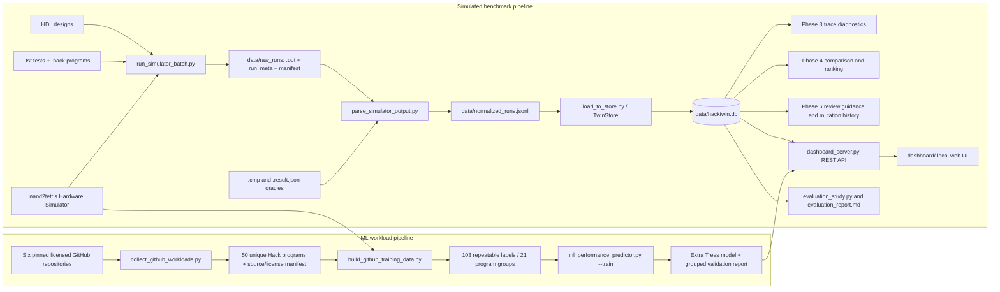

> **Historical document (2026-10-19).** Superseded by `README.md`, `docs/AUDIT.md` and `reports/EXPERIMENT_REPORT.md`. Its statement that designs 1-3 "measured the same cycle counts" referred to `.tst` row counts, which are fixed by the test script and cannot differ between designs (see `docs/AUDIT.md`, finding 1).

# HackTwin Review and Operating Guide

**Project:** nand2tetris Hack CPU Digital Twin  
**Repository reviewed:** `EOC-2 - Copy/hacktwin_run`  
**Guide updated:** 2026-10-19  
**Scope:** HackTwin only. The separate `Desktop/code` Battery Oracle project is not part of this guide.

## 1. What the project does

HackTwin runs one or more Hack CPU HDL designs against Hack machine-code workloads using the nand2tetris Hardware Simulator. It parses the simulator’s `.out` traces, stores measured runs in SQLite, and provides trace review, design comparisons, evidence-linked diagnostics, a trained cycle-count estimate, and a local web dashboard.

The “digital twin” here is a software record and analysis pipeline for HDL simulation. It does not measure a physical chip, gate delay, clock frequency, area, power, or critical path. A cycle-count difference means that one simulated design took a different number of Hack clock steps on the same benchmark. It is not by itself proof of hardware speedup.

The source and outputs in this project show the actual state. Phase names below describe the implemented modules; the roadmap is not treated as evidence.

## 2. Current project state

The repaired project was run end to end on the bundled benchmark suite.

- Three CPU designs are registered: Design 1 (baseline), Design 2 (equivalent jump-logic rewrite), and Design 3 (a valid variant generated by the mutation engine).
- The Hardware Simulator completed 18 official benchmark runs: 3 designs × 3 benchmarks × 2 repeats.
- The stored twin contains 3 designs, 18 runs, and 18 trace channels.
- All repeats completed. Add measured 14 cycles and output `5`; Max measured 26 cycles and output `23456`; Rect measured 64 cycles and passed its `.cmp` expected-output comparison.
- Designs 1, 2, and 3 measured the same cycle counts on all three supplied benchmarks. The project therefore demonstrates correctness and comparison, not a cycle-count improvement from the jump refactor.
- GitHub collection fetched 50 unique `.hack` programs from six pinned repositories. The current simulator-labeled set contains 103 repeatable examples from 21 distinct program hashes. Programs without a suitable loop label and unsuccessful or inconsistent runs are excluded.
- The trained Extra Trees model has 5-fold grouped cross-validation MAE of **439.507 cycles**, compared with a **513.194-cycle median baseline**. Its grouped CV R² is **-0.0856**, and the 90th percentile absolute CV error is **1081.178 cycles**. This is a modest MAE improvement with weak explanatory/generalization strength; estimates are exploratory and should be checked by simulation.
- The primary dashboard leads with a plain-language purpose statement, definitions, current comparison findings, and an explicit ML training summary. Its five views are Purpose & results, Inspect a run, Compare CPUs, ML estimate, and Trace review.
- Phase 6 guidance now shows trace evidence and a validation step. It no longer fabricates cycle savings or emits speculative HDL snippets. Mutation generation replaces the CPU jump section safely; comparison does not copy parent runs to simulate a child.
- `evaluation_report.md` is regenerated from the actual stored runs and model validation report.

### Remaining limitations

1. The ML dataset has only 21 unique program groups. The grouped cross-validation R² is below zero, despite lower MAE than the median baseline. The displayed error range is broad and is not a guaranteed prediction interval.
2. Training targets are cycles to a repeated terminal self-loop pattern. Workloads without that recognized pattern, workloads that do not reach it within the cycle limit, and inconsistent runs are not labeled.
3. Phase 3 signals are trace heuristics. They identify execution concentration, register activity, and write patterns; they do not establish hardware root cause.
4. `performance_predictor.py` remains as a legacy analytical estimator. The dashboard uses `ml_performance_predictor.py`; treat the legacy script’s risk, confidence, and cycle values as heuristics.
5. `streamlit_app/` contains the earlier analytics prototype. The supported presentation interface is the simplified static dashboard served by `app.py` / `dashboard_server.py`.
6. The current mutation is behaviorally equivalent on the bundled tests. It does not establish a timing improvement; the Hardware Simulator does not report one.

## 3. Architecture and data flow



### Benchmark data flow

1. `designs/<id>/*.hdl` and `benchmarks/*.tst` are copied to a scratch folder for each run.
2. The Hardware Simulator executes the `.tst`, writes `.out` trace files, and returns process / comparison metadata.
3. `parse_simulator_output.py` collapses simulator tick/tock output, derives per-channel traces, resolves declared result fields, and records a passing `compare-to` `.cmp` result when the benchmark uses that oracle.
4. `data/normalized_runs.jsonl` holds one normalized JSON object per run.
5. `TwinStore` loads each run and channel into SQLite and tracks design hashes, parent lineage, and mutation history.
6. Phases 3 and 4 query the same persisted trace data. Phase 6 turns observations into review steps. Phase 7 serves the UI and API. Phase 8 evaluates the data that is actually present.

### ML data flow

1. The collector downloads pinned archives from six repositories with MIT or Apache-2.0 license files, assembles `.asm` sources with the local nand2tetris assembler, validates `.hack` binaries, deduplicates by SHA-256, and saves attribution.
2. The label builder runs selected programs on Design 1 with five initial RAM profiles and two repeats. It accepts a label only if a terminal-loop pattern is observed and both repeats agree.
3. The model extracts static Hack instruction/control-flow counts plus RAM inputs. It predicts cycles to the target loop.
4. Holdout and GroupKFold validation split by program hash, so scenarios from the same program do not leak into both training and validation folds.
5. The dashboard’s `POST /api/predict` looks up an eligible collected workload by ID, predicts with the saved model, and displays the grouped validation result and error range.

## 4. What each phase currently does

| Phase | Implemented behavior | Main files | Current status |
|---|---|---|---|
| 0 — Benchmarking and simulator integration | Runs each design/benchmark pair headlessly, repeats runs, captures `.out`, simulator metadata, and expected-output comparison status. | `run_simulator_batch.py`, `benchmarks/*.tst`, nand2tetris tools | Working on the supplied setup; 18/18 current runs completed. |
| 1 — Trace parsing and normalization | Parses output channels, removes partial/settled duplicates, records PC/register/memory traces and declared outputs. Supports result specs and `.cmp` verification. | `parse_simulator_output.py` | Working; 18 normalized run records. |
| 2 — Digital Twin Store | Creates SQLite schema for designs, runs, channels, mutations, and summary view. Loads JSONL and supports summary, lineage, and comparison queries. | `twin_store.py`, `load_to_store.py` | Working; stores 3 designs / 18 runs / 18 channels. Full reload preserves linked mutation history. |
| 3 — Bottleneck and root-cause analysis | Computes PC frequencies, backward-PC/loop activity, A/D register updates, and memory-write concentrations from traces. | `bottleneck_analysis.py` | Working as a trace heuristic. It does not prove physical hardware root cause. |
| 4 — Comparison and ranking | Aggregates same-benchmark cycle counts, checks declared outputs across repeats, compares design hashes, and ranks stored designs. | `comparison_engine.py` | Working. Bundled designs tie at 14/26/64 cycles for Add/Max/Rect. |
| 5 — Performance prediction and data preparation | Collects public workloads; labels them through local simulation; fits Extra Trees on log cycles; reports holdout and program-group CV metrics. Legacy heuristic also remains. | `collect_github_workloads.py`, `build_github_training_data.py`, `ml_performance_predictor.py`, `performance_predictor.py` | Pipeline works. Predictive strength remains limited; use the grouped validation report. |
| 6 — Review guidance and mutation | Produces evidence-linked inspection steps with explicit verification and no invented savings. Mutation engine creates a safe jump-logic child and requires real simulator runs before comparison. | `recommendation_generator.py`, `mutation_engine.py` | Working. Current Design 3 passes configured outputs and ties Design 1 on cycles. |
| 7 — Dashboard and API | Serves the simplified local UI plus JSON routes for summary, designs, runs, trace diagnostics, comparison, recommendations, and ML prediction. | `dashboard_server.py`, `dashboard/`, `app.py` | Working; local UI and prediction route verified. |
| 8 — Evaluation | Reloads normalized runs, computes comparison/ranking, reads ML validation artifacts, and writes the report. | `evaluation_study.py`, `evaluation_report.md` | Working; no same-data train/test score is presented as validation. |

## 5. Environment and one-time setup

Run commands from the HackTwin project root:

```sh
cd "/Users/cow/Desktop/EOC-2 - Copy/hacktwin_run"
python3 --version
python3 -m venv .venv
source .venv/bin/activate
python3 -m pip install -r requirements.txt
```

The simulator and assembler are expected at `../nand2tetris/tools/HardwareSimulator.sh` and `../nand2tetris/tools/Assembler.sh`. The runner resolves a path-like simulator command before changing into a scratch directory, so this relative path works when run from the project root.

**Expected:** Python version prints; package installation completes. No console output is required from environment activation.  
**Proves:** The Python environment and required NumPy / scikit-learn / joblib packages are available.  
**Common failures:** `python3` missing; pip cannot reach the package index; `ModuleNotFoundError` for a listed package. Check `python3 --version`, activate `.venv`, and rerun `python3 -m pip install -r requirements.txt`.  
**Verify success:** `python3 -c 'import numpy, sklearn, joblib; print("dependencies ok")'` prints `dependencies ok`.

## 6. Runnable components and their contracts

All path examples below assume the project root is the current directory.

| Component / command | Purpose and inputs | Outputs | Verify it works |
|---|---|---|---|
| `python3 run_simulator_batch.py ...` | Phase 0. Reads design folders, `.tst` benchmarks, simulator launcher, and repeat count. | `data/raw_runs/<design>__<benchmark>__rN/*.out`, `run_meta.json`, `manifest.json`. | Each run has an `.out`, `returncode: 0`, and for supplied `.cmp` tests `comparison_ok: true`. |
| `python3 parse_simulator_output.py ...` | Phase 1. Reads raw run directories, benchmark result specs, and `.cmp` files. | Normalized `data/normalized_runs.jsonl`. | Run count matches raw manifest; check each benchmark’s declared output or `.cmp` result. |
| `python3 load_to_store.py` | Phase 2. Reads normalized JSONL; full load replaces stored run data and retains mutation history whose designs still exist. | SQLite database at `data/hacktwin.db`. | `python3 summary.py` reports nonzero counts; `--query summary` lists records. |
| `python3 summary.py` | Prints database counts; accepts optional `--db`. | Design, run, and channel counts. | Current output: 3 / 18 / 18. |
| `python3 bottleneck_analysis.py --run-id <id>` | Phase 3. Reads one run’s trace from SQLite. | PC hotspots, loops, register activity, write hotspots, heuristic trace findings. | Report includes run ID and observed trace values. |
| `python3 comparison_engine.py --designs A,B` | Phase 4. Reads two designs and shared runs from SQLite. | Per-benchmark cycle deltas and declared-output checks. | Current comparison 1 vs 2: outputs match; cycle counts equal. |
| `python3 performance_predictor.py ...` | Legacy analytical estimator. Accepts `.hack` or manually entered feature counts. | Heuristic cycle/risk/hotspot outputs. | It prints a warning that it is legacy. Do not cite these values as trained-model validation. |
| `python3 collect_github_workloads.py` | Downloads pinned GitHub archives; assembles `.asm`; filters and hashes valid `.hack`. | `data/github_workloads/programs/`, `licenses/`, `source_manifest.json`. | Manifest has six sources and 50 unique programs; licenses are saved beside attribution. |
| `python3 build_github_training_data.py ...` | Runs accepted workloads on Design 1 with five initial RAM profiles and repeat checks. | `training_data.jsonl`, `dataset_build_report.json`, raw traces and logs under `data/github_workloads/`. | Current report: 103 labels, 21 program groups, repeated cycles agree for each accepted label. |
| `python3 ml_performance_predictor.py --train` | Fits and validates the trained ML model from simulator-labeled JSONL. | `data/models/hacktwin_cycle_model.joblib` and `.validation.json`. | Report contains holdout and GroupKFold metrics, group count, target definition, and limitations. |
| `python3 ml_performance_predictor.py --hack-file ...` | Predicts cycles for a binary Hack program using the saved model. | Predicted target-loop cycles, approximate CV error range, validation metrics. | Response says estimate and includes sample/group counts and validation. |
| `python3 recommendation_generator.py --run-id ...` | Phase 6. Reads a stored trace. | Review-level items with observed evidence, interpretation, next step, and rerun validation. | Every item says savings were not estimated. |
| `python3 mutation_engine.py --history` | Reads evolution records from SQLite. | Parent/child, mutation type, simulator cycle-count change, status. | Current Design 1 → 3 record is `PASSED`, 0.0% cycle-count reduction. |
| `python3 evaluation_study.py` | Phase 8. Reloads normalized JSONL, updates design lineage, reads ML report, compares/ranks, writes Markdown report. | `evaluation_report.md`; refreshed SQLite data. | Prints 3 designs / 18 runs / 18 channels and grouped CV metrics. |
| `python3 app.py --port 8080` | Starts local dashboard/API; `dashboard_server.py` is the server implementation. | Local site at `http://127.0.0.1:8080`. | `/api/summary` returns current counts; page shows connected status. |
| `python3 -m unittest discover -v` | Runs the project’s automated tests. | Per-test results. | Current project: 57 tests pass. |

`streamlit_app/` is an earlier unconnected prototype. `app.py` now starts the supported static dashboard, not Streamlit.

## 7. Main commands: expected output, failure cases, and success checks

### 7.1 Phase 0 — run the bundled simulator suite

```sh
python3 run_simulator_batch.py --designs-dir designs --benchmarks-dir benchmarks --out-dir data/raw_runs --sim-cmd "../nand2tetris/tools/HardwareSimulator.sh" --repeat 2
```

**Expected:** 18 `[run]` records for 3 designs × 3 benchmarks × 2 repeats, each ending `status=0` and listing an output file; final line says `Wrote 18 run records -> data/raw_runs/manifest.json`.  
**Proves:** All current HDL designs load in the Hardware Simulator, the supplied benchmarks execute, and both repeats were recorded.  
**Common failures:** Simulator launcher path is wrong; nand2tetris tools are missing; a malformed CPU produces a nonzero run or no `.out`; a failing expected-output compare has `comparison_ok: false`.  
**Verify success:** Inspect `data/raw_runs/manifest.json`; for all 18 records require return code 0 and at least one `.out`. Require `comparison_ok: true` for the supplied `.cmp` benchmarks.

### 7.2 Phase 1 — normalize traces

```sh
python3 parse_simulator_output.py --raw-dir data/raw_runs --benchmarks-dir benchmarks --out-file data/normalized_runs.jsonl
```

**Expected:** `Normalized 18 runs -> data/normalized_runs.jsonl`.  
**Proves:** Raw output has been parsed into one normalized record per run and the benchmark outputs are resolvable.  
**Common failures:** Raw run folders or `.out` files are missing; an unknown result field is named in a `.result.json`; the run ID has no output file.  
**Verify success:** Count 18 nonempty lines in `data/normalized_runs.jsonl`; current result checks are Add=5, Max=23456, Rect `.cmp` pass.

### 7.3 Phase 2 — load and query SQLite

```sh
python3 load_to_store.py
python3 summary.py
python3 load_to_store.py --query summary
```

**Expected:** Load prints `Store stats: 3 designs, 18 runs, 18 channels`; `summary.py` prints the same counts; the query prints run IDs, cycles, outputs, and repeat indices.  
**Proves:** Normalized JSON is persisted, queryable, and grouped by design/benchmark.  
**Common failures:** Missing/invalid JSONL; permission or path issue; database locked by another process.  
**Verify success:** `python3 -c 'from twin_store import TwinStore; s=TwinStore("data/hacktwin.db"); print(s.design_count(),s.run_count(),s.channel_count()); s.close()'` prints `3 18 18`.

**Reload note:** A full `load_to_store.py` run replaces stored runs and channels from `normalized_runs.jsonl`; it preserves mutation-history rows only when both referenced designs remain in the new data. Keep a copy of custom runs before replacing the canonical JSONL/DB.

### 7.4 Phase 3 — inspect one trace

```sh
python3 bottleneck_analysis.py --run-id 1__ComputerAdd__r0
```

**Expected:** A trace report for 14 cycles with PC frequency, A/D register updates, RAM writes, and a “Trace Findings” section.  
**Proves:** The phase reads persisted telemetry and derives repeatable counts.  
**Common failures:** Run ID not in the store; no instruction trace; run data not loaded.  
**Verify success:** The report ID matches `1__ComputerAdd__r0`; its cycle and writes agree with the same row in `data/normalized_runs.jsonl`.

### 7.5 Phase 4 — compare designs and verify outputs

```sh
python3 comparison_engine.py --designs 1,2
python3 comparison_engine.py --rank
```

**Expected:** Three shared benchmarks. Design 1 and 2 both measure Add=14, Max=26, Rect=64; each row reports `MATCH [OK]`. Ranking lists all three stored designs.  
**Proves:** Shared benchmark cycle counts and all repeats’ declared outputs are compared.  
**Common failures:** A design is absent; no shared benchmarks; one benchmark has no declared output or simulator `.cmp` result; outputs mismatch.  
**Verify success:** Compare exact per-benchmark counts, require `MATCH [OK]`, and interpret ties as ties. This suite contains no measured cycle reduction.

### 7.6 Phase 5 — collect and simulate GitHub workloads

```sh
python3 collect_github_workloads.py
python3 build_github_training_data.py --max-cycles 4096 --repeats 2
```

**Expected collection:** `Collected 50 unique Hack programs from 6 licensed repositories.` Program count is deduplicated machine-code count; accepted source-file counts may exceed 50.  
**Expected label build:** `Created 103 repeatable simulator labels across 21 unique program groups.` Some programs are excluded because they lack the recognized terminal self-loop; some candidate/profile runs do not yield a stable target before the limit.  
**Proves:** Public code supplies program inputs, but HackTwin’s own simulator supplies training labels and repeatability checks.  
**Common failures:** No network access for collection; missing local assembler; simulator or HDL invalid; unsupported/no terminal loop; workload exceeds cycle cap; repeats disagree.  
**Verify success:** Inspect `source_manifest.json` and saved license files. In `dataset_build_report.json`, check accepted labels, program groups, excluded programs, and rejected measurements. Every accepted row must say `simulated_and_repeatable` and have equal `repeat_cycles`.

**Pinned sources and licenses:**

- [Gunasekare/nand2tetris](https://github.com/Gunasekare/nand2tetris) — MIT
- [ArhanChaudhary/NAND](https://github.com/ArhanChaudhary/NAND) — MIT
- [y1hao/Nand2Tetris](https://github.com/y1hao/Nand2Tetris) — MIT
- [aalhour/Assembler.hack](https://github.com/aalhour/Assembler.hack) — MIT
- [appleweiping/nand2tetris](https://github.com/appleweiping/nand2tetris) — MIT
- [AdamJelley/Nand2Tetris](https://github.com/AdamJelley/Nand2Tetris) — Apache-2.0

The exact commit hashes, repository URLs, paths, source kinds, SPDX IDs, and license-file names are recorded in `data/github_workloads/source_manifest.json`. Collection uses GitHub archive URLs pinned to those commit hashes and exact binary SHA-256 deduplication.

### 7.7 Phase 5 — train, validate, and predict

```sh
python3 ml_performance_predictor.py --train --json
python3 ml_performance_predictor.py --hack-file data/github_workloads/programs/gh_00896ed4c87b.hack --ram0 0 --ram1 0 --json
```

**Expected training:** 103 examples, 21 groups; 25% held-out-program MAE about 391.067 cycles vs median baseline 518.690; 5-fold grouped CV MAE about 439.507 vs median baseline 513.194. R² is -0.0856; 90th percentile CV absolute error is about 1081.178 cycles.  
**Proves:** Training, held-out program evaluation, grouped cross-validation, model persistence, and a real pre-simulation prediction.  
**Common failures:** Fewer than four unique programs; missing Hack file; malformed machine word; no trained model.  
**Verify success:** Files exist at `data/models/hacktwin_cycle_model.joblib` and `data/models/hacktwin_cycle_model.validation.json`; the JSON contains group counts and baseline metrics. Treat the wide error range and negative R² as an explicit limitation, not a hidden warning.

The target is **cycles to the first detected repeated terminal self-loop PC pattern** under the supplied Hack CPU HDL and selected RAM inputs. It is not general execution-time prediction for arbitrary programs, and it is not a physical timing estimate.

### 7.8 Phase 6 — inspect recommendations and mutation history

```sh
python3 recommendation_generator.py --run-id 1__ComputerAdd__r0
python3 mutation_engine.py --history
```

**Expected recommendations:** Observed A-register or RAM-write evidence for Add, a plain-language interpretation, an inspection action, and a same-input simulator verification step. Every recommendation states cycle savings are not estimated.  
**Expected history:** Design 1 → Design 3 `JUMP_FASTPATH`, status `PASSED`, cycle-count reduction `0.0%`.  
**Proves:** Phase 6 produces verifiable diagnostic follow-up, and the mutation outcome comes from actual stored child runs.  
**Common failures:** Missing run or missing history record; parent/child do not have shared runs; outputs not declared/verified. The mutation engine reports `PENDING_SIMULATION` until real child runs are loaded.  
**Verify success:** No recommendation contains an asserted saving or unvalidated HDL snippet; mutation status says `PASSED` only when outputs are verified for all shared comparisons.

To create an additional variant, use a new unused design ID (example: `--new-id 4`). The generator will not delete/overwrite an existing design folder. It emits a pending result until you run the same `.tst` tests on the child and load those traces.

### 7.9 Phase 7 — start the dashboard and use its views

```sh
python3 app.py --port 8080
```

**Expected terminal:** `HackTwin Digital Twin Dashboard Server listening on http://127.0.0.1:8080`, plus the selected DB path.  
**Expected browser:** Purpose & results displays 3 CPU versions, 18 simulator executions, and 3 test programs. The five navigation items are Purpose & results, Inspect a run, Compare CPUs, ML estimate, and Trace review.  
**Proves:** Static UI, REST API, SQLite data, recommendation engine, and saved ML model are connected.  
**Common failures:** Port 8080 already occupied; server points to another DB; no local trained model; stale page assets. Use another port, check `--db`, train the model if missing, and refresh the browser.  
**Verify success:** The header says `Local twin connected`; the model status displays training groups, grouped CV MAE vs baseline, R², and CV error range. A prediction is labeled as an estimate, not a measured run.

Stop the server with **Ctrl+C** in its terminal. Open `http://127.0.0.1:8080` in a browser.

### 7.10 Phase 8 — regenerate the evidence report

```sh
python3 evaluation_study.py
```

**Expected:** `Evaluation complete: 3 designs, 18 runs, 18 channels.` The script prints the grouped CV MAE and whether it is below the median baseline, then writes `evaluation_report.md`.  
**Proves:** The report reflects the current normalized JSONL, current HDL hashes, actual comparison results, and saved model validation.  
**Common failures:** Normalized JSONL is missing/empty; model validation report is absent; database path is locked.  
**Verify success:** Open `evaluation_report.md`; require verified outputs for Add, Max, Rect, zero cycle-count change between supplied variants, and the real holdout/CV metrics. Do not restore the previous stale two-run report.

### 7.11 Test command

```sh
python3 -m unittest discover -v
```

**Expected:** `Ran 57 tests ... OK`.  
**Proves:** Store, parser helpers, analysis/comparison, dashboard handlers, mutation guard, recommendation output, and ML validation logic pass their unit tests.  
**Common failures:** Missing dependencies; an assertion failure after editing a component.  
**Verify success:** Process exits with code 0 and final line is `OK`. Unit tests do not replace the 18 real simulator runs or the grouped ML validation.

## 8. Dashboard routes and API contracts

The server binds to `127.0.0.1` by default. JSON APIs are served from the same origin as the UI.

| Route | Method and inputs | Purpose and output | Quick verification |
|---|---|---|---|
| `/` | GET | Serves the dashboard HTML. | `curl -fsS http://127.0.0.1:8080/` includes `HackTwin`. |
| `/style.css`, `/app.js` | GET | Serves dashboard styles and interactions. | `curl -fsSI http://127.0.0.1:8080/style.css`. |
| `/api/summary` | GET | Counts and rankings for stored designs/runs/channels. | JSON includes `design_count: 3`, `run_count: 18`, `channel_count: 18`. |
| `/api/designs` | GET | Design records plus lineage. | Returns IDs `1`, `2`, `3`; 2 and 3 descend from 1. |
| `/api/runs` | GET; optional `?design=1&benchmark=ComputerAdd` | Run summaries. | Filter returns the two repeats and measured cycles. |
| `/api/runs/{run_id}` | GET | One run’s telemetry, trace, registers, memory writes, channels, and declared output. | `/api/runs/1__ComputerAdd__r0` includes 14 cycles and output 5. |
| `/api/bottlenecks/{run_id}` | GET | Heuristic trace counts/findings. | Output includes PC hotspots, churn, memory writes, and a scope note. |
| `/api/compare?designs=1,2` | GET | Shared benchmark cycle deltas and whether outputs are verified/match across repeats. | Three benchmark rows, all outputs verified and matching. |
| `/api/recommendations/{run_id}` | GET | Evidence-linked review steps. | Each item includes evidence, interpretation, validation step, and null savings estimate. |
| `/api/ml/status` | GET | Model availability, sample/group counts, holdout/grouped CV metrics and model quality comparison. | Current `ready: true`, 103 samples, 21 groups. |
| `/api/ml/workloads` | GET | Workload IDs that have simulator labels and are eligible for prediction. | Current response includes 21 program IDs. |
| `/api/predict` | POST JSON `{ "program_id": "gh_00896ed4c87b", "ram0": 0, "ram1": 0 }` | Predicts cycles for a labeled collected workload; returns estimate, approximate CV error range, validation metrics, and limitation note. | Use the example POST below; require HTTP 200 and `status: estimated`. |

### API commands to demonstrate

```sh
curl -fsS http://127.0.0.1:8080/api/summary
curl -fsS 'http://127.0.0.1:8080/api/compare?designs=1,2'
curl -fsS http://127.0.0.1:8080/api/ml/status
curl -fsS -X POST http://127.0.0.1:8080/api/predict -H 'Content-Type: application/json' -d '{"program_id":"gh_00896ed4c87b","ram0":0,"ram1":0}'
```

**Expected:** Summary shows 3/18/18; comparison shows Add 14/14, Max 26/26, Rect 64/64 with outputs matching; model status includes validation metrics; prediction returns a numeric estimate and its CV error range.  
**Proves:** The data route, store, comparison layer, model file, and request validation all function through HTTP.  
**Common failures:** `curl: (7)` means server is stopped/wrong port; HTTP 503 means no trained model; HTTP 400 means invalid/unlabeled program ID or RAM outside 0–32767.  
**Verify success:** `curl -f` returns exit code 0; parse the JSON and check response values/fields above.

## 9. Phase-by-phase testing checklist

### Phase 0 — Simulator integration

- [ ] Confirm `../nand2tetris/tools/HardwareSimulator.sh` exists.
- [ ] Run the Phase 0 command with `--repeat 2`.
- [ ] Confirm 18 records in the raw manifest.
- [ ] Confirm every run has `returncode: 0`, an `.out` file, and the expected-output compare passes where `.cmp` applies.
- [ ] Confirm two repeats agree on the declared benchmark output.

### Phase 1 — Trace normalization

- [ ] Run `parse_simulator_output.py` after Phase 0.
- [ ] Confirm 18 normalized JSONL records.
- [ ] Confirm Add and Max expose their declared RAM result values.
- [ ] Confirm Rect’s `program_output` records the Hardware Simulator `.cmp` pass.
- [ ] Inspect one record’s `channels`, `instruction_trace`, `register_snapshot`, and `memory_access_log`.

### Phase 2 — SQLite twin store

- [ ] Run `load_to_store.py`.
- [ ] Confirm 3 designs, 18 runs, and 18 channels.
- [ ] Query summaries and lineage.
- [ ] Reload once and confirm the run count remains 18 rather than duplicating records.
- [ ] Confirm linked mutation history survives a reload when both designs remain in JSONL.

### Phase 3 — Trace diagnostics

- [ ] Run `bottleneck_analysis.py --run-id 1__ComputerAdd__r0`.
- [ ] Check PC counts against its stored 14-cycle trace.
- [ ] Check A/D update and RAM write counts against trace records.
- [ ] Read findings as workload observations; do not infer physical delay or HDL root cause from counts alone.

### Phase 4 — Comparison and ranking

- [ ] Compare Designs 1 and 2.
- [ ] Confirm shared benchmark count is 3.
- [ ] Confirm Add 14 vs 14, Max 26 vs 26, Rect 64 vs 64.
- [ ] Confirm all outputs verified and match.
- [ ] Confirm no cycle reduction is claimed for these designs.
- [ ] Run `--rank` and explain that ranks aggregate the stored benchmark cycle counts; ties are not evidence of superiority.

### Phase 5 — Workload collection and ML

- [ ] Run the GitHub collector and inspect six pinned repository entries and stored licenses.
- [ ] Confirm 50 unique programs in the current source manifest.
- [ ] Run the label builder with two repeats and a 4096-cycle cap.
- [ ] Confirm 103 accepted labels across 21 source-program hash groups; rejected/unlabeled cases are documented.
- [ ] Train with `--train --json`.
- [ ] Confirm the validation split is grouped by SHA-256 program hash and includes both median baseline and model MAE.
- [ ] Confirm the current MAE improves over baseline, while also reporting R² < 0 and wide absolute error.
- [ ] Make a prediction for a labeled workload and state aloud that it is an estimate to be verified by simulation.

### Phase 6 — Guidance and mutation lifecycle

- [ ] Generate review signals for a stored run.
- [ ] Confirm each signal cites telemetry evidence and gives a verification step.
- [ ] Confirm cycle savings are not estimated.
- [ ] Run mutation history; current Design 3 must show `PASSED` only after real comparisons.
- [ ] Confirm Design 3 is valid HDL, simulator output checks pass, and its measured cycle count ties Design 1.
- [ ] In a disposable copy, generate a fresh variant ID and confirm status stays pending until simulator runs are loaded.

### Phase 7 — UI and API

- [ ] Start with `python3 app.py --port 8080`.
- [ ] Open `http://127.0.0.1:8080` and confirm connected status and 3/18/18 counts.
- [ ] Use Inspect a run to see a measured result and trace, with PC and register terms explained.
- [ ] Use Compare CPUs and verify output checks before reading cycle counts.
- [ ] Use ML estimate and inspect what was trained, what it predicts, grouped validation, and its limitations.
- [ ] Use Trace review and inspect evidence / next action.
- [ ] Verify API summary, compare, model status, and prediction with the curl examples.

### Phase 8 — Evaluation report

- [ ] Run `python3 evaluation_study.py` after Phase 0–2 and model training.
- [ ] Confirm the report uses current hashes and counts.
- [ ] Confirm every benchmark comparison shows whether output was verified.
- [ ] Confirm the model section reads the saved holdout/grouped CV report, not an in-sample score.
- [ ] Confirm the report states no measured cycle advantage for the supplied design variants.

## 10. Complete end-to-end validation procedure

Use this when rebuilding the project evidence from the source files. Run from the project root. The simulator and normalized/store steps replace the canonical raw/normalized run artifacts and SQLite run records; preserve custom data first if needed.

```sh
python3 -m unittest discover -v
python3 run_simulator_batch.py --designs-dir designs --benchmarks-dir benchmarks --out-dir data/raw_runs --sim-cmd "../nand2tetris/tools/HardwareSimulator.sh" --repeat 2
python3 parse_simulator_output.py --raw-dir data/raw_runs --benchmarks-dir benchmarks --out-file data/normalized_runs.jsonl
python3 load_to_store.py
python3 evaluation_study.py
```

Then run the ML branch when refreshing workload data or training a new model:

```sh
python3 collect_github_workloads.py
python3 build_github_training_data.py --max-cycles 4096 --repeats 2
python3 ml_performance_predictor.py --train --json
python3 evaluation_study.py
```

Finally start the server in one terminal and run the API checks in another:

```sh
python3 app.py --port 8080
```

```sh
curl -fsS http://127.0.0.1:8080/api/summary
curl -fsS 'http://127.0.0.1:8080/api/compare?designs=1,2'
curl -fsS http://127.0.0.1:8080/api/ml/status
curl -fsS -X POST http://127.0.0.1:8080/api/predict -H 'Content-Type: application/json' -d '{"program_id":"gh_00896ed4c87b","ram0":0,"ram1":0}'
```

**End-to-end pass criteria:** 57 unit tests pass; 18 official runs have return code 0 and expected output success; JSONL contains 18 rows; SQLite has 3/18/18; design comparisons verify outputs with 0 cycle-count delta; the ML report documents group validation and limitations; API returns all requested data; the browser renders all five views.

## 11. Reviewer demo script

Have two terminals open at the project root. Keep the browser visible at `http://127.0.0.1:8080`.

| Step | Command / screen | What to say | What it proves | Common failure and quick check |
|---:|---|---|---|---|
| 1 | Terminal A: `python3 app.py --port 8080` — server banner appears. | “This starts the local HackTwin API and dashboard against the project SQLite twin.” | Phase 7 launch path and database connection. | If port busy, use `--port 8081`, then open that port. |
| 2 | Purpose & results — show the project explanation, definitions, current comparison, and trained-model summary. | “HackTwin is a software test bench: it runs the same Hack programs on different CPU HDL versions, checks saved results, and compares simulator steps. It does not test a physical chip.” | Project purpose and measured-versus-estimated distinction. | If the data is missing, read the server status and check the database path. |
| 3 | Inspect a run — select CPU 1 · ComputerAdd · repeat 0; show 14 measured steps and output 5. | “A run is one program executed on one CPU version. The trace records the instruction address and register observations during simulation.” | Phase 1 parser, Phase 2 store, trace view. | If the run list is empty, run phases 0–2 and refresh. |
| 4 | Compare CPUs — choose CPU 1 and CPU 2; select Compare these versions. | “The saved outputs agree on Add, Max, and Rect. Both versions use 14, 26, and 64 simulator steps respectively, so this dataset shows no cycle-count improvement.” | Phase 4 output verification and cycle comparison. | If no rows appear, confirm both versions have shared benchmark runs. |
| 5 | ML estimate — show the explicit “Yes — one model has been trained” statement, then make an estimate. | “One Extra Trees regression model was trained on 103 simulator-labeled cases from 21 programs gathered from six public GitHub repositories. It predicts cycles to a repeated terminal loop. The error is large and R² is negative, so I would verify a prediction by simulation.” | GitHub collection, simulator-generated labels, model training, grouped validation, and UI integration. | If model unavailable, run collection, label builder, and `ml_performance_predictor.py --train`. |
| 6 | Trace review — use the Add run. | “These are patterns observed in the trace with a suggested next check. They are review clues, not proof of a hardware fault or guaranteed savings.” | Phase 3 observations feeding Phase 6 review guidance. | If no notes appear, check the run selector and `/api/recommendations/<run-id>`. |
| 7 | Terminal B: `python3 mutation_engine.py --history`. | “Design 3 is a generated jump-logic refactor. It has real simulator comparisons and passes the declared outputs, but it ties the baseline cycles.” | Mutation lineage, no synthetic copied runs, validated outcome. | If history is blank, rerun mutation generation and its real child simulations/ingest flow. |
| 8 | Terminal B: `python3 evaluation_study.py`. Open `evaluation_report.md`. | “Phase 8 assembles the current evidence: test counts, output checks, actual cycle deltas, and grouped model validation. It avoids treating training fit as validation.” | Reproducible report and project-level summary. | If report lacks the model section, train the model first; if counts stale, rebuild phases 0–2. |

### Short spoken close

“HackTwin links HDL simulation, trace parsing, an SQLite twin, design comparison, evidence-based review, and an ML estimate trained on simulator-generated labels. The current benchmark variants are functionally correct and tie on cycle counts. The model beats a median MAE baseline under program-group validation, but its negative R² and wide error mean it remains exploratory. The system keeps those limits visible so the review distinguishes measured facts from estimates.”

## 12. Every executable entry point

| Entry point | Launch form | Use |
|---|---|---|
| `app.py` | `python3 app.py --port 8080` | Primary dashboard launcher. |
| `dashboard_server.py` | `python3 dashboard_server.py --port 8080 [--db PATH] [--host 127.0.0.1]` | Direct server/API launcher. |
| `run_simulator_batch.py` | `python3 run_simulator_batch.py --help` | Phase 0 batch simulation. |
| `parse_simulator_output.py` | `python3 parse_simulator_output.py --help` | Phase 1 normalization. |
| `load_to_store.py` | `python3 load_to_store.py --help` | Phase 2 ingestion and queries. |
| `summary.py` | `python3 summary.py [--db PATH]` | Store count summary. |
| `bottleneck_analysis.py` | `python3 bottleneck_analysis.py --help` | Phase 3 diagnostics. |
| `comparison_engine.py` | `python3 comparison_engine.py --help` | Phase 4 comparison/ranking. |
| `performance_predictor.py` | `python3 performance_predictor.py --help` | Legacy heuristic estimator; not dashboard ML. |
| `collect_github_workloads.py` | `python3 collect_github_workloads.py --help` | Licensed, pinned workload collection. |
| `build_github_training_data.py` | `python3 build_github_training_data.py --help` | Simulator-backed target generation. |
| `ml_performance_predictor.py` | `python3 ml_performance_predictor.py --help` | Model training/validation and inference. |
| `recommendation_generator.py` | `python3 recommendation_generator.py --help` | Phase 6 evidence-linked review guidance. |
| `mutation_engine.py` | `python3 mutation_engine.py --help` | HDL variant creation and actual-run comparison/history. |
| `evaluation_study.py` | `python3 evaluation_study.py --help` | Phase 8 report generation. |
| Unit tests | `python3 -m unittest discover -v` | Runs the 57 automated tests. |

## 13. Final status report

### Completed features

- Headless batch execution with repeat tracking, output capture, and simulator compare status.
- Trace parsing for PC, opcode when available, register snapshots, memory writes, multi-channel output, result specs, and `.cmp` verification.
- SQLite design/run/channel/mutation schema, lineage helpers, safe full reload, and CLI queries.
- PC hotspot, loop, register-activity, and memory-write trace analysis with scope caveats.
- Shared-benchmark design comparisons, across-repeat output verification, cycle-count ranking.
- Pinned licensed GitHub workload collection, assembly, validation, hashing, and attribution.
- Repeated Hardware Simulator labels for 21 program groups and a persisted Extra Trees model with holdout and group CV report.
- Evidence-linked, non-quantified recommendations and safe jump-logic mutation lifecycle.
- Simplified browser dashboard, local API endpoints, and model prediction connection.
- Phase 8 report using current stored evidence and cross-validation artifacts.
- 57 passing unit tests and 18 successful bundled simulator runs.

### Completed phases

Phases 0 through 8 have an executable implementation and a verification path. Phase 5’s data coverage/model strength, Phase 3’s heuristic root-cause scope, and the absence of physical timing/area measurements are limitations, not claims of completed physical optimization.

### Remaining work

- Expand to more unique, diverse, permissively licensed programs and additional source repositories.
- Add benchmark families that exercise longer, more varied control-flow and RAM behavior; broaden the target beyond recognized terminal loops.
- Improve feature engineering and calibrate uncertainty on a larger source-grouped holdout; consider a final untouched repository-level test set.
- If the project must claim HDL timing or area improvements, integrate a separate synthesis/timing/area tool and report those measurements separately from simulator cycles.
- Either remove the Streamlit prototype or finish it only if a second interface is still needed.

### Risks to state in a viva

- A lower MAE than a median baseline does not guarantee reliable prediction; the current negative grouped CV R² and ±1081-cycle 90th-percentile absolute error show uncertainty.
- Source-code license compliance and attribution must remain with any redistributed dataset; the collector writes the license files and per-program source manifest.
- A high PC or register count is not evidence of an HDL critical path.
- Design 2 and Design 3 show no bundled cycle-count improvement; do not repeat the former “10% speedup” claim from the stale report.
- The trained model predicts a specific simulator-derived loop target, not physical runtime for arbitrary software.

### Suggested next steps

1. Demonstrate the current reproducible baseline with the Reviewer Demo Script.
2. Grow the dataset by distinct program groups first, then retrain and compare grouped CV MAE, R², and error range.
3. Add a simulator test for any new HDL variant before changing its mutation status from pending.
4. If required by the project rubric, add real hardware timing/area measurement as a separately validated phase.
5. Prepare the PPT only after this guide and review results are stable.
