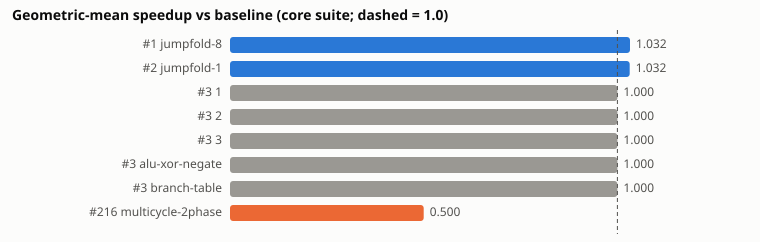
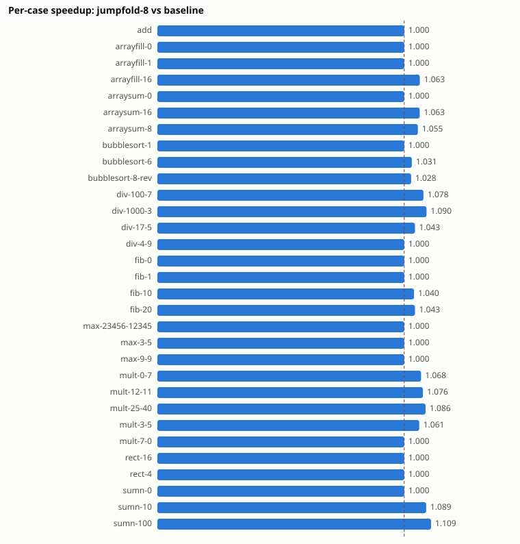
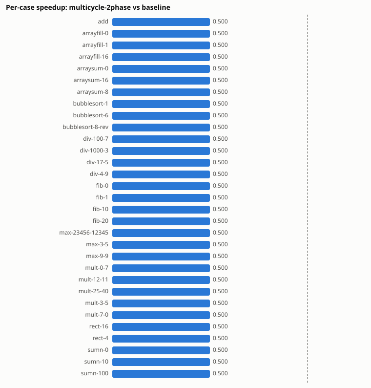

# HackTwin experiment report

Generated 2026-10-21 17:09:29 by `generate_report.py` from the twin store (schema v3). Simulator: nand2tetris Hardware Simulator (`HardwareSimulator.sh`), openjdk version "11.0.32" 2026-07-21 LTS, Python 3.14.7.

All cycle counts are **simulated clock cycles to halt** measured by the official Hardware Simulator through the TwinComputer harness. They are not wall-clock times, and no clock period, area or power was measured.

Core suite: 10 programs, 31 input cases (add, arrayfill, arraysum, bubblesort, div, fib, max, mult, rect, sumn). Baseline: design `1`.

## Designs and correctness

| Design | Kind | Execution model | Official tests passed | Core cases correct | Repeat-consistent | Write-equivalent to ISA | Mean CPI |
|---|---|---|---|---|---|---|---|
| `1` | baseline | single-cycle (CPI = 1) | 6/6 | 31/31 | 31/31 | 31/31 | 1.000 |
| `2` | internal_variant | single-cycle (CPI = 1) | 6/6 | 31/31 | 31/31 | 31/31 | 1.000 |
| `3` | mutation | single-cycle (CPI = 1) | 6/6 | 31/31 | 31/31 | 31/31 | 1.000 |
| `alu-xor-negate` | internal_variant | single-cycle (CPI = 1) | 6/6 | 31/31 | 31/31 | 31/31 | 1.000 |
| `branch-table` | internal_variant | single-cycle (CPI = 1) | 6/6 | 31/31 | 31/31 | 31/31 | 1.000 |
| `jumpfold-1` | internal_variant | single-cycle with jump folding (CPI <= 1) | 6/6 | 31/31 | 31/31 | 31/31 | 0.970 |
| `jumpfold-8` | internal_variant | single-cycle with jump folding (CPI <= 1) | 6/6 | 31/31 | 31/31 | 31/31 | 0.969 |
| `multicycle-2phase` | internal_variant | multi-cycle (CPI = 2) | 1/6 (fails: CPU, CPU-external, ComputerAdd, ComputerMax, ComputerRect) | 31/31 | 31/31 | 31/31 | 2.000 |

The official cycle-exact tests (CPU.tst, Computer*.tst) fail for `multicycle-2phase` by design: it takes two cycles per instruction. Memory.tst is excluded because it waits for interactive keyboard input.

## Comparison with the baseline

Speedup = baseline cycles / candidate cycles; aggregate = geometric mean over comparable cases.

| Candidate | HDL difference vs baseline | Comparable cases | Fewer / tie / more | Geo-mean speedup | Total cycle reduction |
|---|---|---|---|---|---|
| `2` | netlist differs | 31/31 | 0 / 31 / 0 | 1.0000 | +0.00% |
| `3` | netlist differs | 31/31 | 0 / 31 / 0 | 1.0000 | +0.00% |
| `alu-xor-negate` | netlist differs | 31/31 | 0 / 31 / 0 | 1.0000 | +0.00% |
| `branch-table` | netlist differs | 31/31 | 0 / 31 / 0 | 1.0000 | +0.00% |
| `jumpfold-1` | netlist differs | 31/31 | 16 / 15 / 0 | 1.0316 | +6.25% |
| `jumpfold-8` | netlist differs | 31/31 | 16 / 15 / 0 | 1.0324 | +6.45% |
| `multicycle-2phase` | netlist differs | 31/31 | 0 / 0 / 31 | 0.5000 | -100.00% |

- **2**: The HDL is structurally different, but cycle counts are identical on all 31 comparable cases: the change had no effect on the measured metric.
- **3**: The HDL is structurally different, but cycle counts are identical on all 31 comparable cases: the change had no effect on the measured metric.
- **alu-xor-negate**: The HDL is structurally different, but cycle counts are identical on all 31 comparable cases: the change had no effect on the measured metric.
- **branch-table**: The HDL is structurally different, but cycle counts are identical on all 31 comparable cases: the change had no effect on the measured metric.
- **jumpfold-1**: Fewer cycles on 16, equal on 15, more on 0 of 31 comparable cases (geometric-mean speedup 1.0316; total cycle reduction 6.25%). Cycle counts are simulated clock cycles; clock period, area and power were not measured, so this is not evidence of faster hardware.
- **jumpfold-8**: Fewer cycles on 16, equal on 15, more on 0 of 31 comparable cases (geometric-mean speedup 1.0324; total cycle reduction 6.45%). Cycle counts are simulated clock cycles; clock period, area and power were not measured, so this is not evidence of faster hardware.
- **multicycle-2phase**: Fewer cycles on 0, equal on 0, more on 31 of 31 comparable cases (geometric-mean speedup 0.5000; total cycle reduction -100.00%). Cycle counts are simulated clock cycles; clock period, area and power were not measured, so this is not evidence of faster hardware.

### Per-case cycles (designs that change timing)

| Case | Baseline | jumpfold-8 | jumpfold-1 | multicycle-2phase |
|---|---|---|---|---|
| add | 6 | 6 | 6 | 12 |
| arrayfill-0 | 12 | 12 | 12 | 24 |
| arrayfill-1 | 27 | 27 | 27 | 54 |
| arrayfill-16 | 252 | 237 | 237 | 504 |
| arraysum-0 | 14 | 14 | 14 | 28 |
| arraysum-16 | 254 | 239 | 239 | 508 |
| arraysum-8 | 134 | 127 | 127 | 268 |
| bubblesort-1 | 8 | 8 | 8 | 16 |
| bubblesort-6 | 603 | 585 | 593 | 1206 |
| bubblesort-8-rev | 1212 | 1179 | 1191 | 2424 |
| div-100-7 | 180 | 167 | 167 | 360 |
| div-1000-3 | 4008 | 3676 | 3676 | 8016 |
| div-17-5 | 48 | 46 | 46 | 96 |
| div-4-9 | 12 | 12 | 12 | 24 |
| fib-0 | 16 | 16 | 16 | 32 |
| fib-1 | 38 | 38 | 38 | 76 |
| fib-10 | 236 | 227 | 227 | 472 |
| fib-20 | 456 | 437 | 437 | 912 |
| max-23456-12345 | 10 | 10 | 10 | 20 |
| max-3-5 | 12 | 12 | 12 | 24 |
| max-9-9 | 12 | 12 | 12 | 24 |
| mult-0-7 | 94 | 88 | 88 | 188 |
| mult-12-11 | 142 | 132 | 132 | 284 |
| mult-25-40 | 490 | 451 | 451 | 980 |
| mult-3-5 | 70 | 66 | 66 | 140 |
| mult-7-0 | 10 | 10 | 10 | 20 |
| rect-16 | 218 | 218 | 218 | 436 |
| rect-4 | 62 | 62 | 62 | 124 |
| sumn-0 | 10 | 10 | 10 | 20 |
| sumn-10 | 110 | 101 | 101 | 220 |
| sumn-100 | 1010 | 911 | 911 | 2020 |

## Ranking

Geometric-mean speedup versus the baseline over every case where the baseline has valid, correct runs. Designs missing any of those cases, or wrong on any, are not ranked. Equal values share a rank. No other metrics are combined into the score.

| Rank | Design | Geo-mean speedup | Ties with |
|---|---|---|---|
| 1 | `jumpfold-8` | 1.0324 | — |
| 2 | `jumpfold-1` | 1.0316 | — |
| 3 | `1` | 1.0000 | 2, 3, alu-xor-negate, branch-table (+208 imported designs) |
| 3 | `2` | 1.0000 | 1, 3, alu-xor-negate, branch-table (+208 imported designs) |
| 3 | `3` | 1.0000 | 1, 2, alu-xor-negate, branch-table (+208 imported designs) |
| 3 | `alu-xor-negate` | 1.0000 | 1, 2, 3, branch-table (+208 imported designs) |
| 3 | `branch-table` | 1.0000 | 1, 2, 3, alu-xor-negate (+208 imported designs) |
| 216 | `multicycle-2phase` | 0.5000 | — |

## GitHub HDL dataset

Repositories discovered: 1346; retrieved: 339 (retrieval is capped per run and resumable; 1005 still pending); with a CPU.hdl: 234.

| Stage | Candidates |
|---|---|
| retrieved | 344 |
| structurally valid | 296 |
| duplicates | 60 |
| unique structurally valid | 236 |
| simulator compatible | 213 |
| correct | 208 |
| complete | 208 |

Ranked imported designs: 208. Their geometric-mean speedups: {1.0: 208} — every correct imported implementation has exactly the baseline's timing (single-cycle, CPI 1). Their netlists differ, but no imported design changes the cycle count.

Why candidates stopped (most frequent first):

- 38 × rejected: PARTS section is empty (unimplemented stub)
- 5 × rejected: parse error: expected '…' but found '…'
- 3 × rejected: part '…' is neither supplied by the design nor a simulator built-in
- 2 × failed_tests: wrong or missing results on N case(s): arrayfill-N, arrayfill-N, arraysum-N, arraysum-N, bubblesort-N, bubbles
- 1 × failed_tests: wrong or missing results on N case(s): arrayfill-N, arrayfill-N, arrayfill-N, arraysum-N, arraysum-N, arraysum
- 1 × failed_tests: wrong or missing results on N case(s): fib-N, fib-N, sumn-N, sumn-N, sumn-N
- 1 × incompatible: simulator error: In HDL file <scratch>/OrNWay.hdl, Line N, a is not a pin in OrNWay: load TwinComputer.hdl
- 1 × rejected: declares CHIP NandN; file name must match chip name
- 1 × rejected: parse error: expected '…' or '…' in part And, found '…'
- 1 × failed_tests: wrong or missing results on N case(s): add, arrayfill-N, arrayfill-N, arrayfill-N, arraysum-N, arraysum-N
- 1 × incompatible: simulator error: In HDL file <scratch>/ALU.hdl, Line N, in(N) and finalOr(N) have different bus widths: load T

Licenses of repositories with a CPU.hdl: MIT: 31, none detected: 189, GPL-3.0: 8, Unlicense: 2, BSD-3-Clause: 1, GPL-2.0: 1, CC0-1.0: 2. Files without a license are cached locally for analysis only and are not redistributed.

## Unsuccessful and superseded runs

Runs from earlier HDL revisions or case configurations are kept for traceability and excluded from comparisons:

- 48 × failed: simulator error: In script <scratch>/case.tst, Line 4, too many arguments

Imported designs that did not pass:

- `gh-harshith200525-nand2tetris-part1-5a354ed-c76f`: simulation failed or did not halt on 18 case(s)
- `gh-jali22ramazan22-nand2tetriscourse-3a77b7b-c975`: simulation failed or did not halt on 18 case(s); wrong results on 11 case(s)
- `gh-jeremyfenwick-hack-e7bef90-db9a`: simulation failed or did not halt on 5 case(s)
- `gh-kochaika-nand2tetris-hw-2025-9f41b44-5a83`: wrong results on 23 case(s)
- `gh-lucabenzi-nand2tetris-cda1396-c975`: no current runs for 31 case(s)
- `gh-reqied-nand-to-tetris-d37a428-c975`: no current runs for 31 case(s)
- `gh-rhodesrt-nand2tetris-75975fc-9170`: simulation failed or did not halt on 5 case(s); wrong results on 16 case(s)

## Performance predictor

Per design: GroupKFold (up to 5 folds) grouped by program SHA-256 (leave-programs-out). No input profile of a held-out program is seen in training. Metrics are over out-of-fold predictions. Dataset: 704 rows, 8 designs, 28 programs.

| Predictor | MAE (cycles) | RMSE | MAPE | p90 abs. error |
|---|---|---|---|---|
| calibrated_isa | 0.60 | 1.15 | 0.33% | 1.8 |
| extratrees_all | 53.68 | 291.50 | 8.92% | 84.0 |
| isa_cpi1 | 60.08 | 106.79 | 6.88% | 186.8 |
| extratrees_static | 403.47 | 652.07 | 484.24% | 993.4 |
| median_baseline | 490.02 | 761.56 | 804.14% | 1406.8 |
| ridge_static | 1965.85 | 13714.54 | 13827.26% | 1068.2 |

Leave-one-design-out: calibrated_isa fitted on the other designs predicts `multicycle-2phase` with MAE 454.4 cycles (MAPE 50.4%) — it does not transfer to an architecture with a different CPI.

Limitations:

- The dynamic features come from the ISA reference emulator, which executes the program. They are cheaper than HDL simulation but they are not a static prediction.
- calibrated_isa needs measured runs of the design it predicts; the leave-one-design-out result shows it does not transfer to a design with a different CPI.
- Several designs have identical timing (listed above); their per-design results are not independent evidence.
- Programs come from 10 HackTwin/nand2tetris workloads and the GitHub workload set; predictions for very different programs (e.g. keyboard-driven or non-halting code) are outside the data.
- The uncertainty band is the 90th-percentile absolute out-of-fold error for that design and model; it is an empirical spread, not a guaranteed interval.

## Known limitations

- The Hardware Simulator measures cycles, not time: no clock period, critical path, area or power results exist in this report.
- Jump folding assumes immutable instruction memory and only folds the canonical 0;JMP encoding.
- Results cover 10 core programs and 19 GitHub workload programs; other workloads may behave differently.
- GitHub discovery processed a bounded, prioritised subset of the repositories found; the remainder is recorded as pending.
- The netlist hash is a Weisfeiler-Lehman fingerprint: equal hashes strongly suggest, but do not prove, identical netlists.
